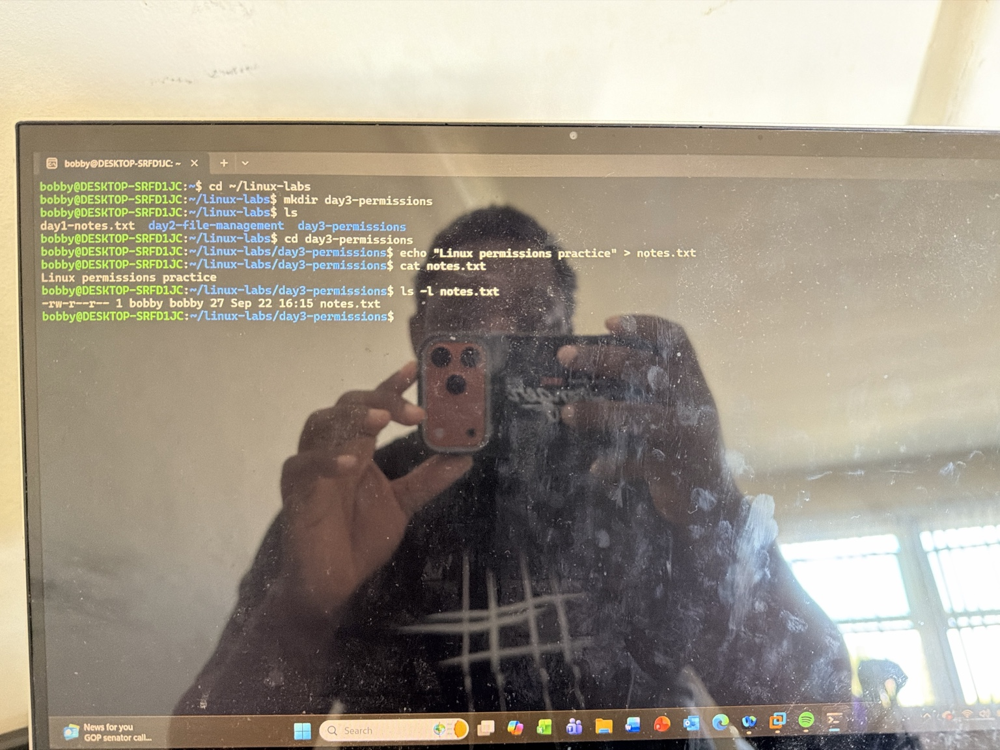
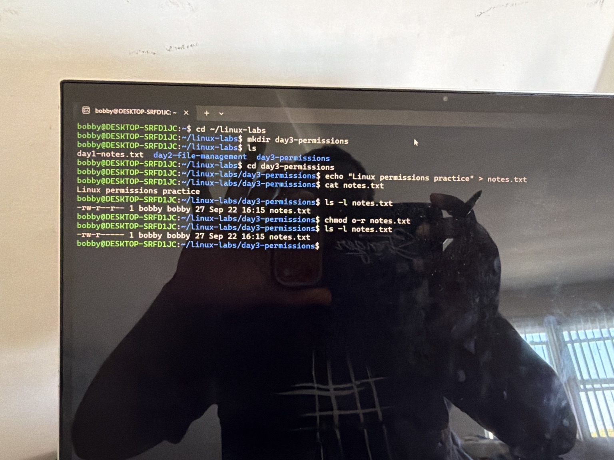
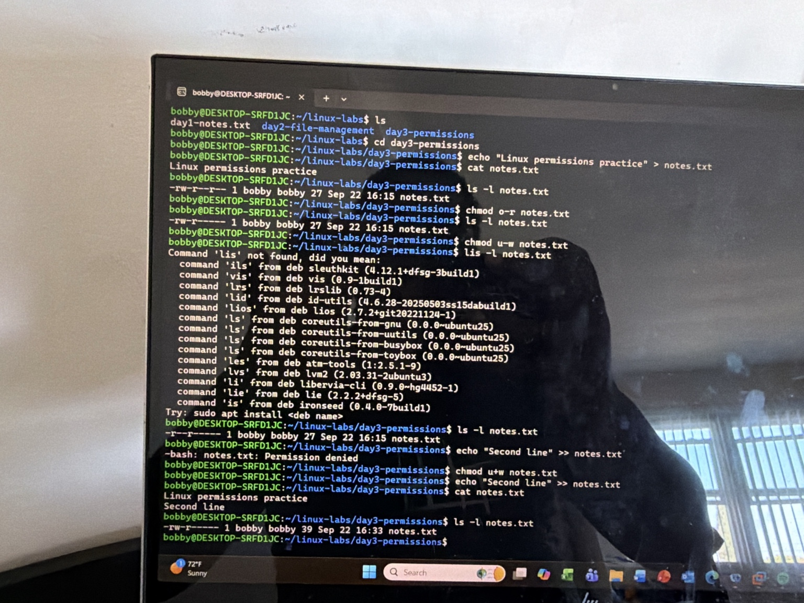
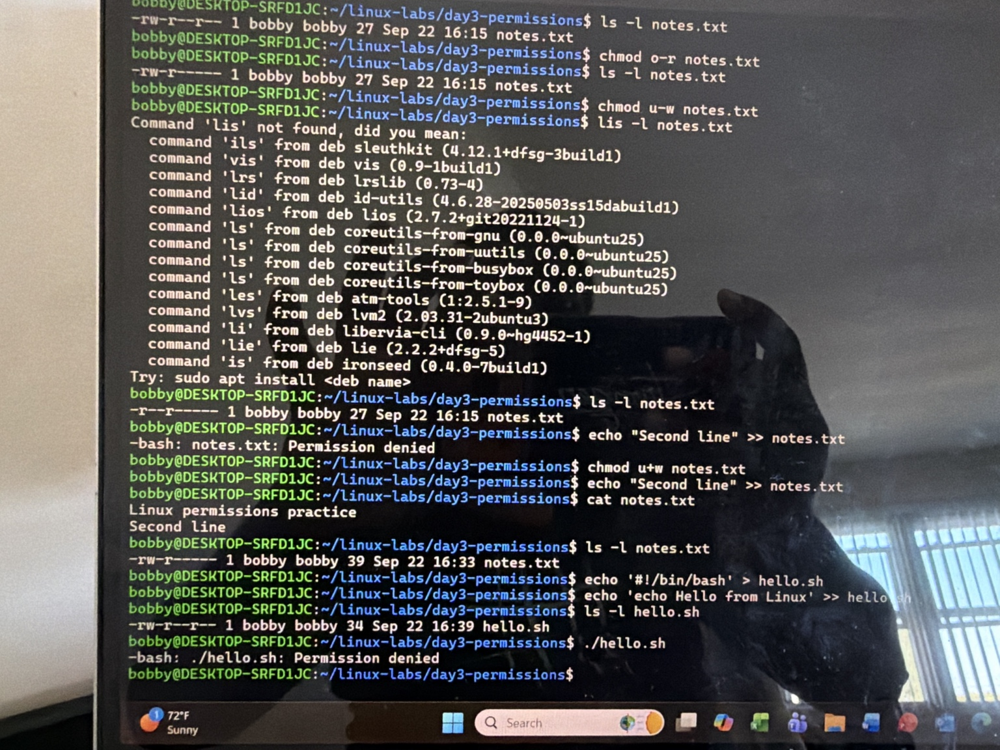
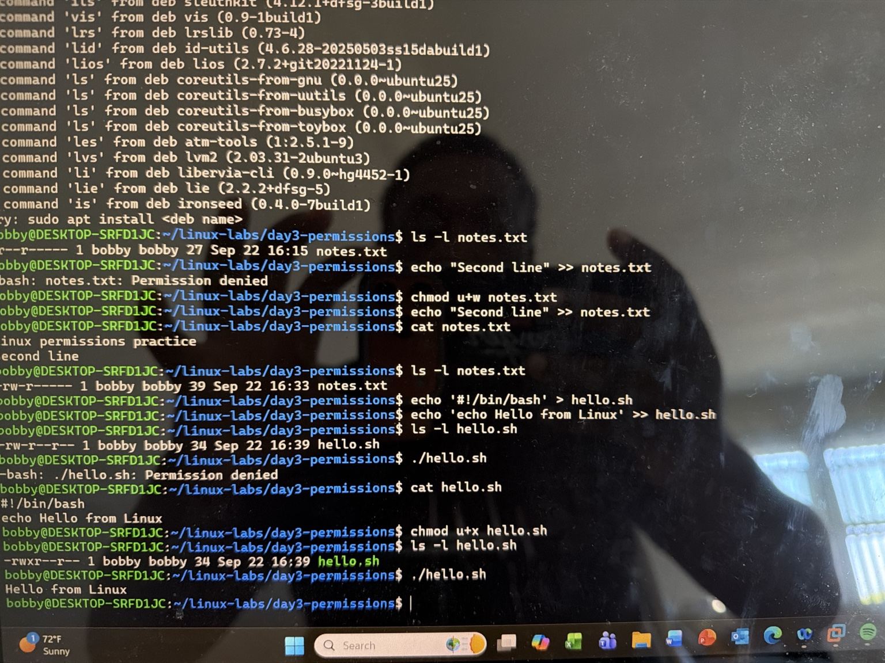
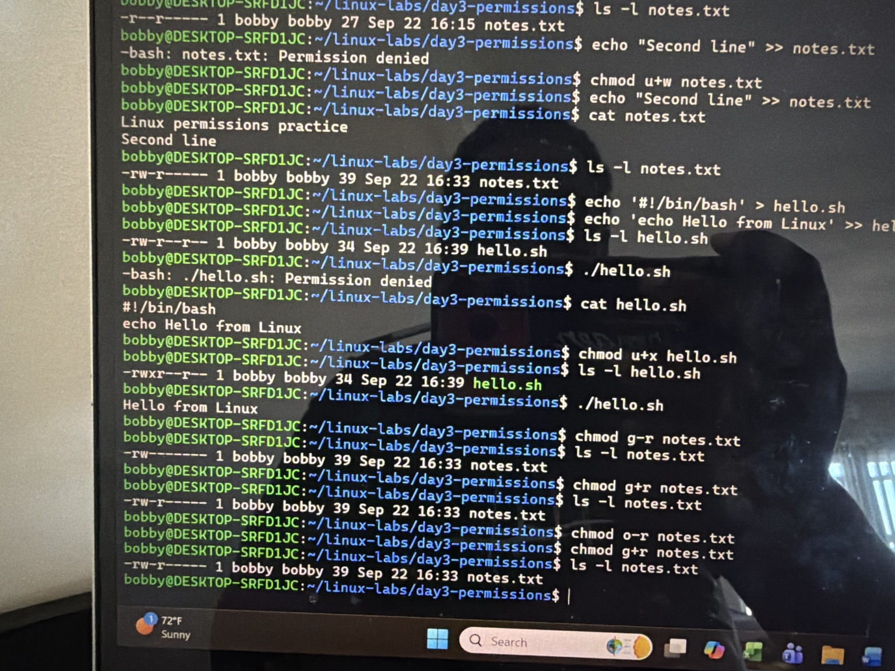

# Linux Day 3: File Permissions

## Overview

I practised Linux file permissions in Ubuntu using a dedicated directory under `~/linux-labs`. I used `ls -l` to inspect permissions, changed read and write access with `chmod`, and confirmed that a script needs execute permission before I can run it directly.

## Lab Environment

- Host: Windows laptop
- Linux environment: Ubuntu through Windows Subsystem for Linux (WSL)
- User: `bobby`
- Lab directory: `/home/bobby/linux-labs/day3-permissions`

## Objectives

- Read the owner, group, and other permission fields shown by `ls -l`.
- Use symbolic `chmod` to add or remove `r`, `w`, and `x`.
- Observe an expected `Permission denied` error and resolve it.
- Distinguish displaying a script from executing it.

## 1. Create and inspect a practice file

```bash
cd ~/linux-labs
mkdir day3-permissions
cd day3-permissions
echo "Linux permissions practice" > notes.txt
cat notes.txt
ls -l notes.txt
```

The initial permissions were `-rw-r--r--`. The first `-` indicates a regular file; the next nine characters are three sets of permissions:

| Set | Initial value | Meaning |
|---|---|---|
| Owner (`u`) | `rw-` | Read and write |
| Group (`g`) | `r--` | Read only |
| Others (`o`) | `r--` | Read only |

The listing identified `bobby` as both the file owner and the owning group. The current user is the file owner, so the owner permission set applies when `bobby` opens it.



## 2. Remove read access for others

```bash
chmod o-r notes.txt
ls -l notes.txt
```

The permissions changed to `-rw-r-----`: the last set changed from `r--` to `---`. In the expression `o-r`, `o` selects others, `-` removes a permission, and `r` selects read.



## 3. Remove and restore the owner's write access

```bash
chmod u-w notes.txt
ls -l notes.txt
echo "Second line" >> notes.txt
```

The append attempt returned `Permission denied`, as expected: the owner no longer had `w` for this file. I restored write access and confirmed that appending worked:

```bash
chmod u+w notes.txt
echo "Second line" >> notes.txt
cat notes.txt
```

The file then contained both `Linux permissions practice` and `Second line`. This demonstrates the difference between changing access with `chmod` and writing data with `echo ... >>`.



## 4. Inspect and run a small Bash script

I created a two-line file:

```bash
echo '#!/bin/bash' > hello.sh
echo 'echo Hello from Linux' >> hello.sh
cat hello.sh
ls -l hello.sh
```

`>` created or overwrote `hello.sh` with its first line, while `>>` appended the second. `#!/bin/bash` is the first line **inside** the file; it tells the system to use Bash when directly executing the script. `cat hello.sh` displayed the contents without carrying out the second line.

Initially, `hello.sh` had no execute (`x`) permission. Direct execution failed:

```bash
./hello.sh
# -bash: ./hello.sh: Permission denied
```

I then added execute permission for the owner:

```bash
chmod u+x hello.sh
ls -l hello.sh
./hello.sh
```

The owner permission set changed from `rw-` to `rwx`, and the script printed `Hello from Linux`. Here `./` means the file is in the current directory. The change from failure to success was the practical test of the execute bit.





## 5. Change the group permission

```bash
chmod g-r notes.txt
ls -l notes.txt
chmod g+r notes.txt
ls -l notes.txt
```

Removing the group's `r` produced `-rw-------`; restoring it produced `-rw-r-----`. The group has read permission in the final state but no write permission. Since `bobby` is also the owner, these commands did not test access as a different group member.

I also identified `chmod g+w notes.txt` as the command that would add write permission for the group. I did not verify a group write access test with a second user.



## Command reference

| Element | Meaning |
|---|---|
| `u` | File owner |
| `g` | Owning group |
| `o` | Other users |
| `r` | Read |
| `w` | Write |
| `x` | Execute a file (for directories, access its entries) |
| `+` | Add a selected permission |
| `-` | Remove a selected permission |

## Troubleshooting notes

- `Permission denied` while appending to `notes.txt` was expected after `chmod u-w`. Restoring `u+w` fixed it.
- `Permission denied` while running `./hello.sh` was expected because it initially lacked `x`. Adding `u+x` fixed it.
- I mistyped `lis` for `ls` once. Bash reported `command not found`; retyping `ls -l` displayed the listing.

## What I learned

Linux checks file permissions for an owner, an owning group, and other users. I can read a permission string such as `-rw-r-----` and change one permission at a time with symbolic `chmod`. I also learned that reading a script with `cat` and running it with `./` are separate operations. This lab used my own practice files and did not require `sudo`.

## Next steps

- Explore user and group membership and file ownership.
- Practise the different meaning of `r`, `w`, and `x` on directories.
- Learn numeric permission notation after the symbolic form is comfortable.
