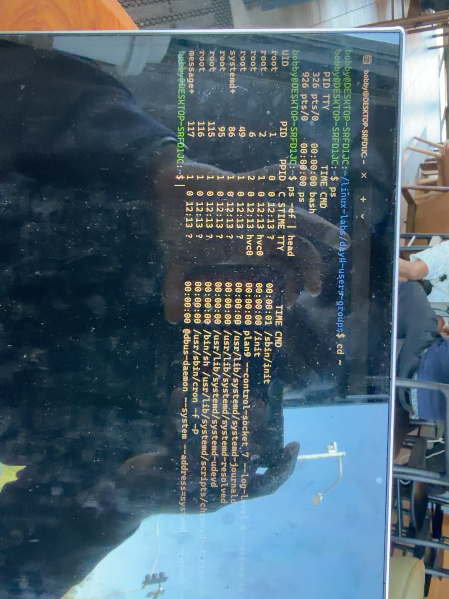
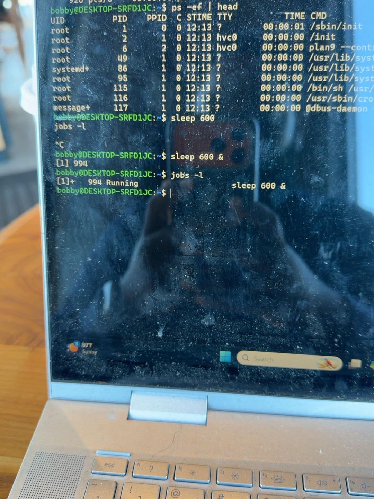
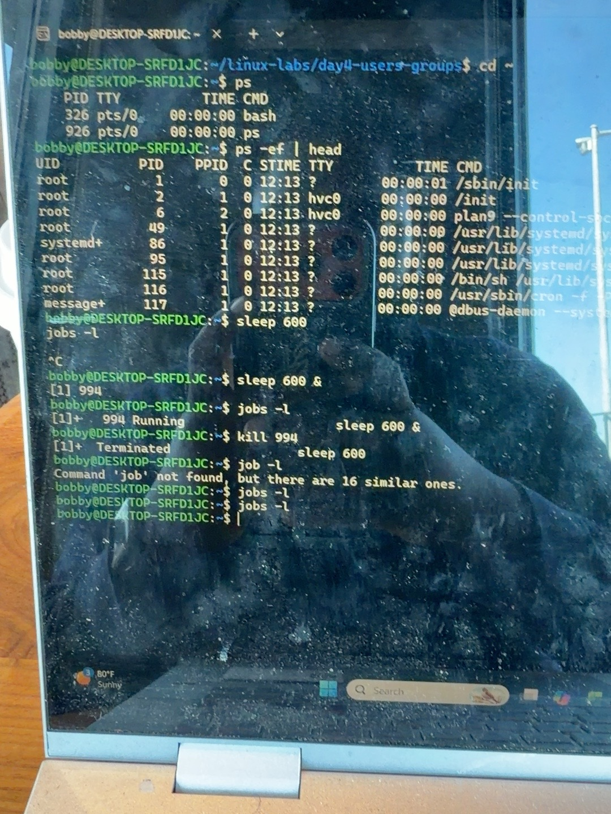
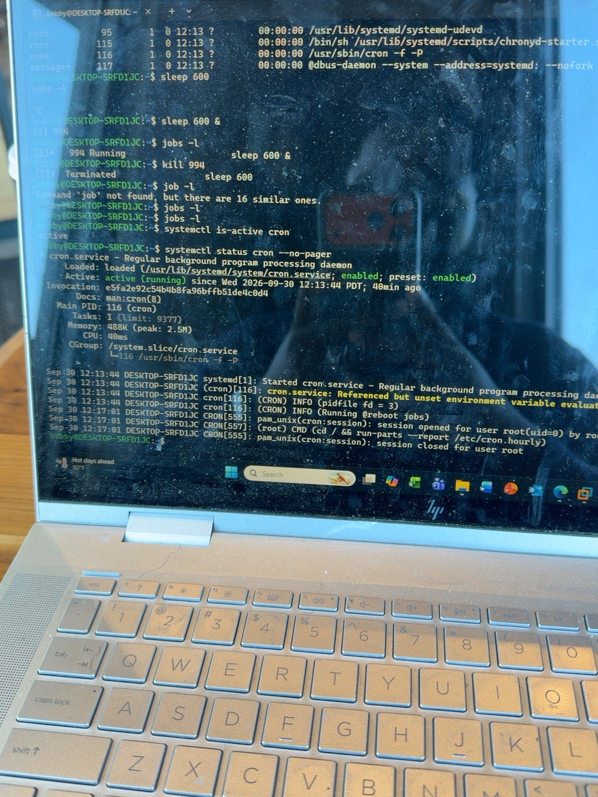
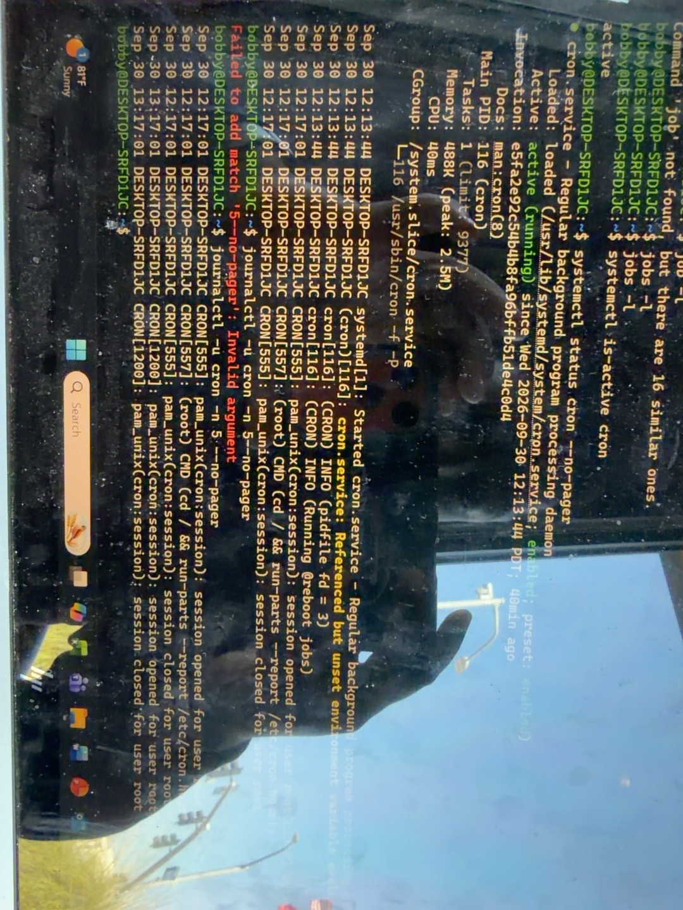
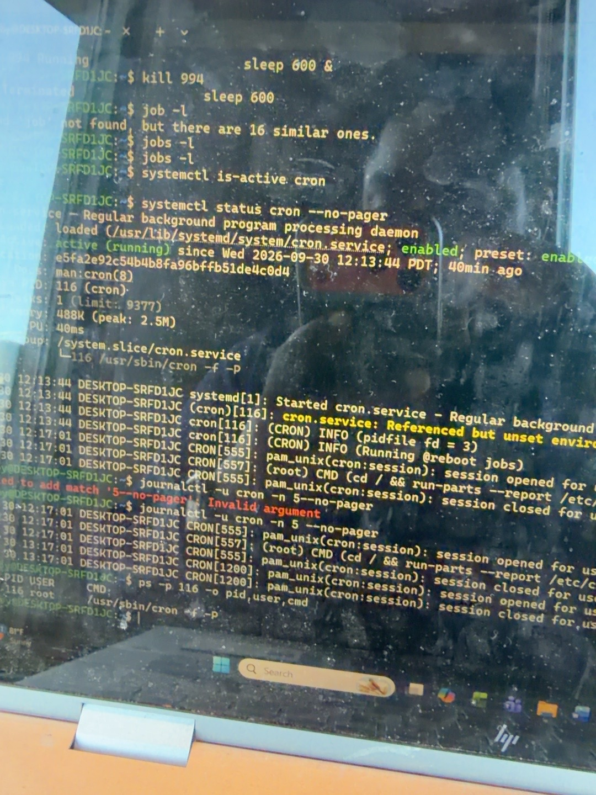
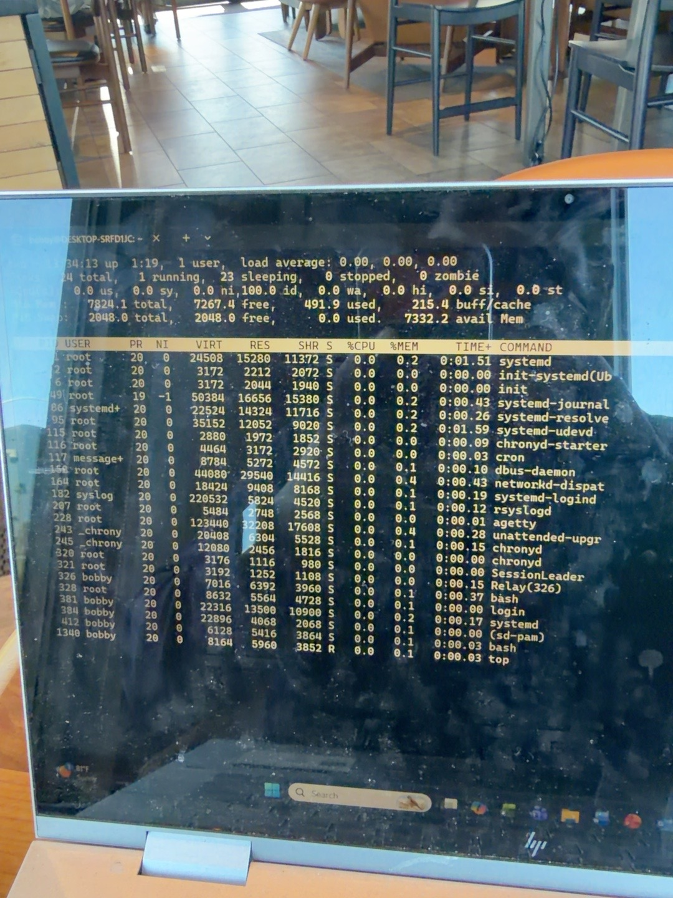

# Linux Day 5 — Processes and Services

## Goal

Find running programs, start and stop a safe practice process, and inspect a real Linux service. This lab was completed in Ubuntu with the `bobby` account.

## Key ideas

- A **process** is a program that is running right now. Linux gives each process a **PID** (process ID).
- A **service** is a program the system manages. A running service also has a process and PID.
- `sleep 600` is a harmless process that waits ten minutes and then ends. It is not a service.
- `cron` is a service that starts commands or scripts at scheduled times. Cron running does not guarantee that every scheduled task succeeds.
- `systemctl` checks and manages services. `journalctl` reads their recorded messages.

## 1. Inspect processes

```bash
ps
ps -ef | head
```

`ps` listed processes attached to the terminal, including `bash` (PID 326 in this session). `ps -ef` listed processes across the system. The `| head` part limited the output to the first few lines. A PID can change in another session, so do not reuse the numbers below blindly.



## 2. Start and stop a practice process

```bash
sleep 600 &
jobs -l
kill 994
jobs -l
```

`sleep 600` waits ten minutes. The `&` put it in the background and returned the prompt immediately. `jobs -l` listed background jobs from this terminal and showed `sleep` with PID **994**. `kill 994` asked that process to terminate; `jobs -l` then showed no running jobs. PID 994 was the observed PID in this lab; use the PID shown on your own screen in a future lab.

The first attempt omitted `&`, so `sleep` occupied the terminal until **Ctrl+C** stopped it. Typing `job -l` instead of `jobs -l` produced a command-not-found error; correcting the spelling worked.





## 3. Check a service

```bash
systemctl is-active cron
systemctl status cron --no-pager
```

`systemctl is-active cron` returned **active**. The detailed status showed **Active: active (running)**, **Loaded: enabled**, and **Main PID: 116**. “Active” describes its current state; “enabled” means it is configured to start automatically when this Linux system starts. `--no-pager` printed the result directly in the terminal.



## 4. Read recent service messages

```bash
journalctl -u cron -n 5 --no-pager
```

`journalctl` reads the system journal. `-u cron` selects messages for the cron service, and `-n 5` shows the latest five. The output included a `CMD` entry, showing that cron launched a scheduled command. A later session-close entry did not by itself prove that the scheduled command completed successfully; its own output or result would need checking.

An initial attempt used `-no-pager` (one dash), which produced an invalid-argument error. The successful form is `--no-pager` (two dashes).



## 5. Match the service to its process

```bash
ps -p 116 -o pid,user,cmd
```

`-p 116` selected the PID shown by `systemctl status`. `-o pid,user,cmd` selected the output columns. The result identified PID **116**, user **root**, and command **`/usr/sbin/cron -f -P`**. The service status and process list were describing the same running program.



## 6. Monitor CPU and memory

```bash
top
```

`top` updates a live list of processes, like Task Manager. `%CPU` shows processor use, `%MEM` shows memory use, and `COMMAND` identifies the program. Press **q** to leave `top`. In the captured moment, displayed processes were near 0% CPU and the CPU summary showed about **100% idle**, so there was no high-CPU process to investigate in that snapshot.



## Troubleshooting lesson

If a scheduled task is missing, check in order:

1. Is the scheduler service running? `systemctl is-active cron`
2. Did the scheduler launch a command? Inspect `journalctl -u cron` for a relevant `CMD` entry.
3. Did that command succeed? Check the task's own output or log. An active scheduler is not proof of task success.

For a slow system, use `top` to identify a process with high CPU or memory use, note its PID and command, and investigate what it is doing before stopping it.

## What I learned

I can distinguish a running process from a system-managed service, identify a PID, start and stop a safe background process, check cron's status, read its journal entries, and inspect live CPU and memory use.
