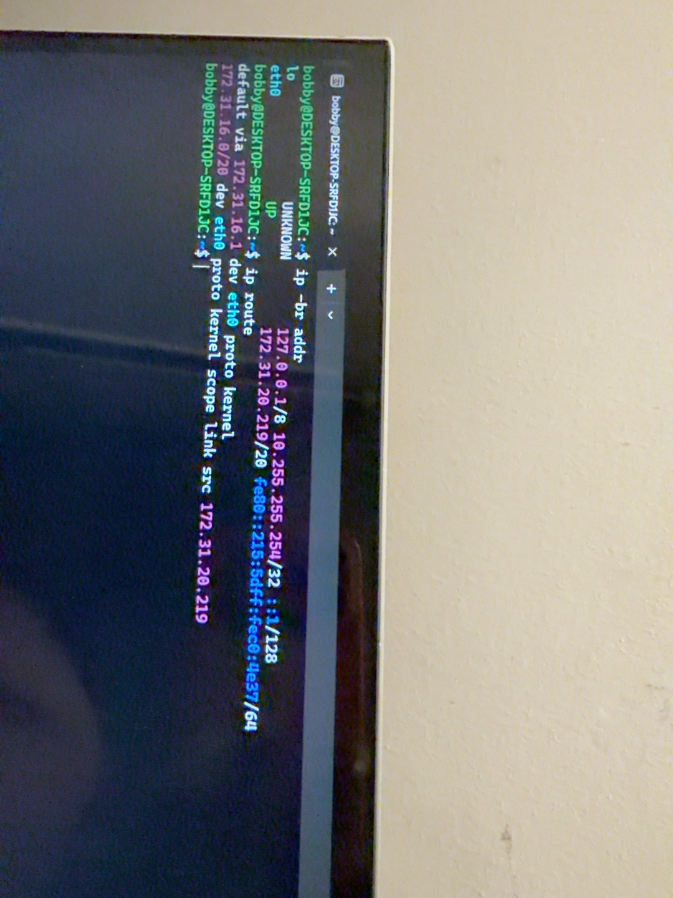
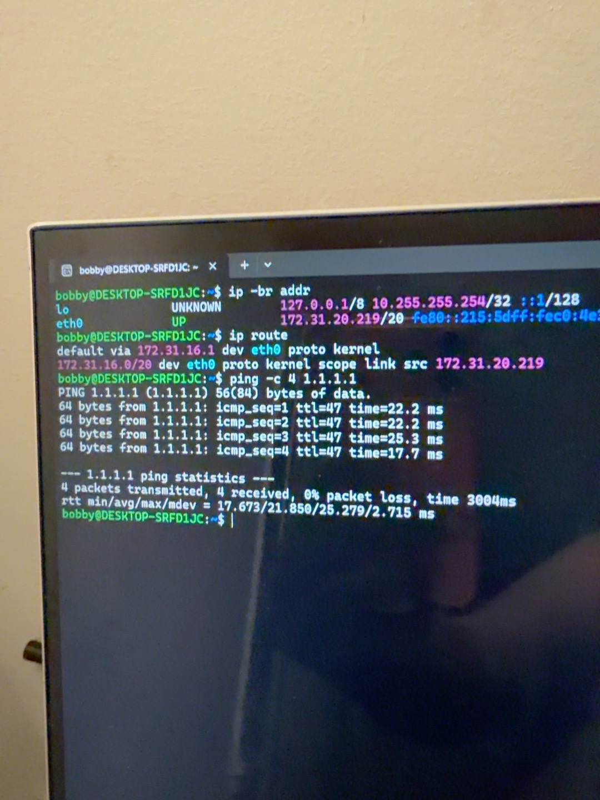
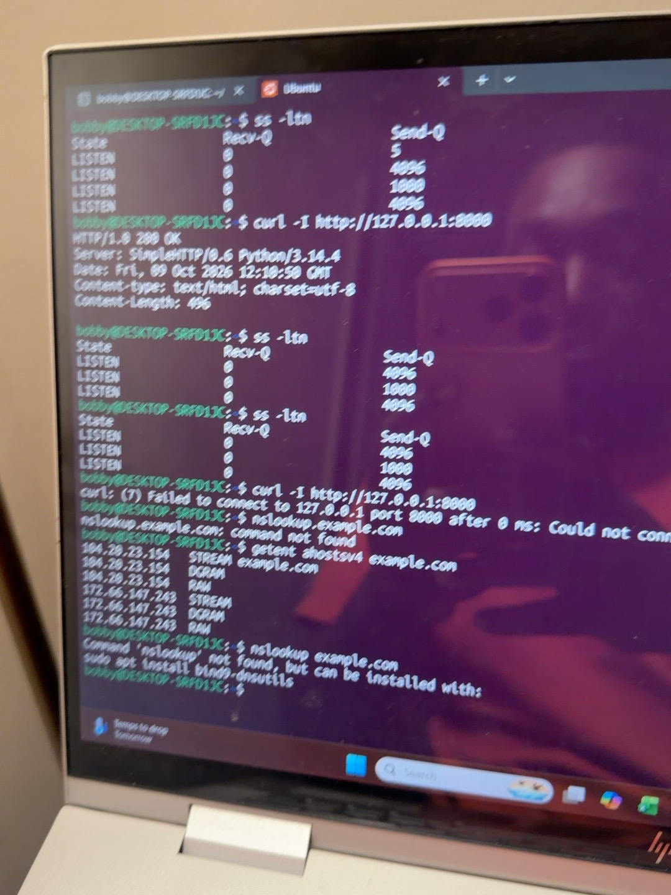
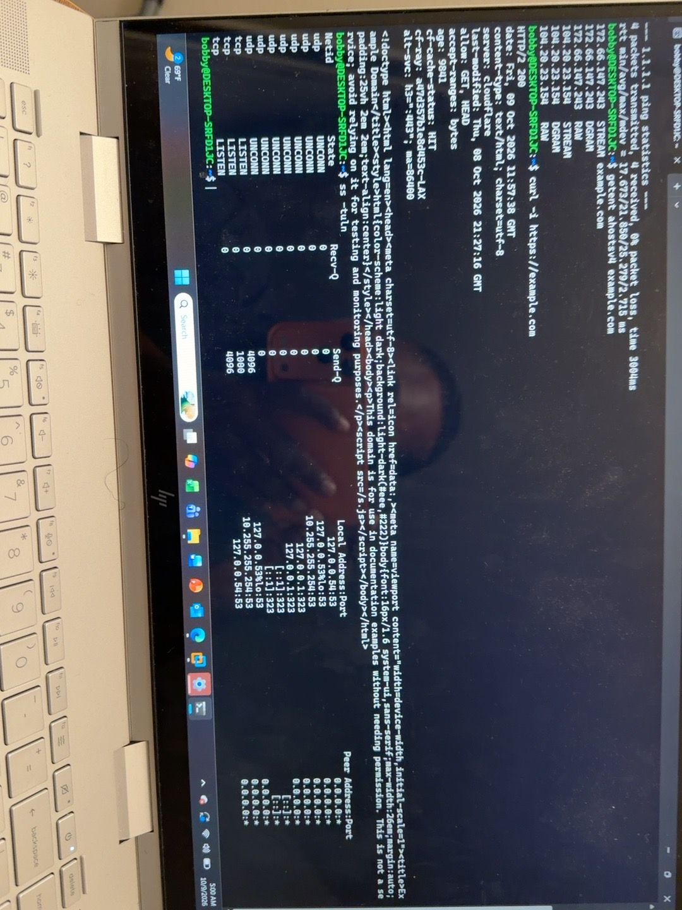
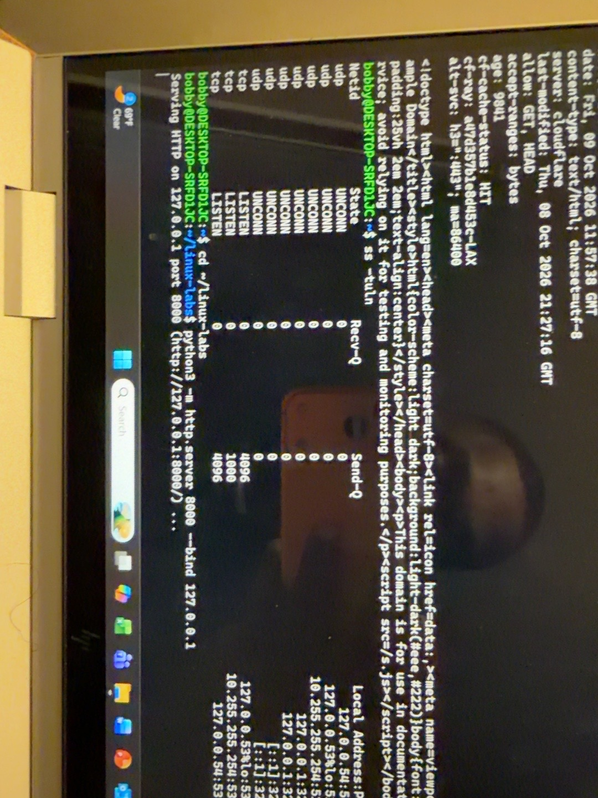
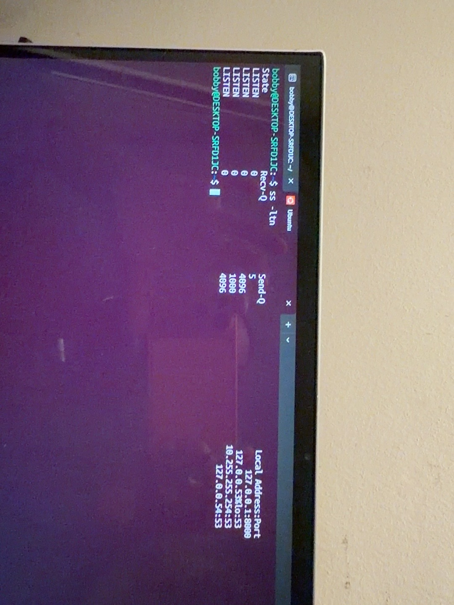
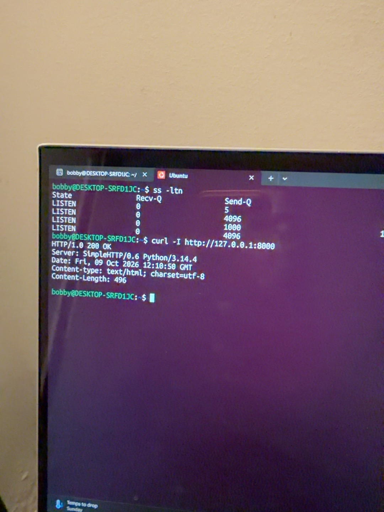
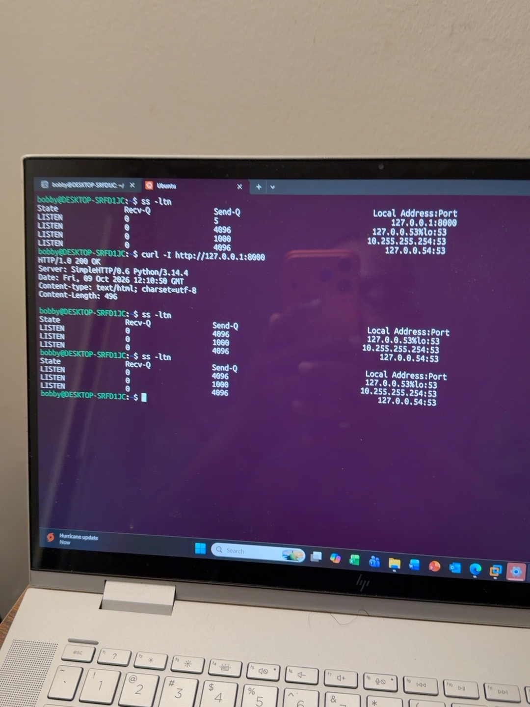
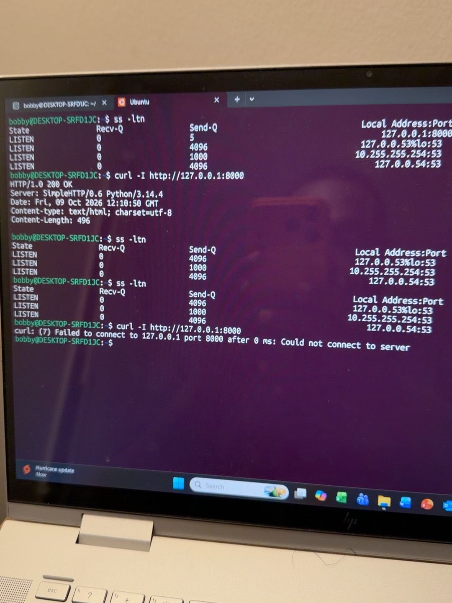

# Linux Day 6: Networking Basics and Troubleshooting

## Goal

Inspect an Ubuntu WSL network connection, test name resolution and reachability, and troubleshoot a local web service. This lab follows a simple sequence: **name → IP address → route → port → application response**.

## Environment

- Ubuntu running in Windows Subsystem for Linux (WSL)
- Shell user: `bobby`
- Lab interface: `eth0`
- Local practice server: Python's built-in HTTP server

The addresses and gateway shown below were observed in this lab. They can change when WSL restarts.

## 1. Check the local IP address

```bash
ip -br addr
```

The output showed `lo` with `127.0.0.1/8` and `eth0` as `UP` with `172.31.20.219/20`. `lo` is the loopback interface used to contact this Ubuntu system itself. `eth0` is the active WSL network interface.

Evidence: [IP address](images/01-ip-address.jpeg).

## 2. Check the route and gateway

```bash
ip route
```

The default route used `172.31.16.1` via `eth0`. A default gateway is the next hop for destinations outside the local network. A connection to `127.0.0.1` stays local and does not need this gateway.

Evidence: [Route and gateway](images/02-route.jpeg).

## 3. Test reachability to an IP address

```bash
ping -c 4 1.1.1.1
```

Four packets were sent and four replies were received, with 0% packet loss. The `-c 4` option stops after four attempts. This checks whether that IP replies to ping; it does not test DNS or whether a website is working.

Evidence: [Ping result](images/03-ping.jpeg).

## 4. Resolve a website name

```bash
getent ahostsv4 example.com
```

Ubuntu returned IPv4 addresses for `example.com`, including `104.20.23.154` and `172.66.147.243`. The output repeats addresses for `STREAM`, `DGRAM`, and `RAW`; the important observation here is that name resolution returned IP addresses. Those addresses can change over time.

I also tried `nslookup example.com`. Ubuntu reported `Command 'nslookup' not found`, meaning that utility was not installed in this environment. It was **not** a DNS failure: `getent` had already resolved the name. An earlier `nslookup.example.com` attempt lacked the required space between command and name.

Evidence: [Name resolution](images/04-name-resolution.jpeg).

## 5. Check an HTTPS response

```bash
curl -I https://example.com
```

`curl` received an `HTTP/2 200` response. The `-I` option requests response headers, which lets us check the HTTP status without displaying the page body.

Evidence: [HTTPS headers](images/05-https-response.jpeg).

## 6. Inspect listening ports

```bash
ss -tuln
```

`ss` listed local TCP and UDP sockets, including entries on port `53` associated with DNS. Here, `-t` means TCP, `-u` UDP, `-l` listening, and `-n` numeric addresses and ports. For a shorter TCP-only list, I used `ss -ltn`. A listening port shows a program is waiting for connections; it does not by itself prove that a remote machine can reach it.

Evidence: [Listening sockets](images/06-listening-ports.jpeg).

## 7. Start and test a local web server

In the first Ubuntu terminal tab:

```bash
cd ~/linux-labs
python3 -m http.server 8000 --bind 127.0.0.1
```

Python reported that it was serving HTTP on `127.0.0.1` port `8000`. The terminal remained occupied because the server ran in the foreground. Binding to `127.0.0.1` kept this practice service local to the WSL system.

In a second Ubuntu tab:

```bash
ss -ltn
curl -I http://127.0.0.1:8000
```

`ss` showed `127.0.0.1:8000` in `LISTEN` state. `curl` returned `HTTP/1.0 200 OK` with `Server: SimpleHTTP/0.6 Python/3.14.4`. This confirmed that a client could connect to the local server and receive an HTTP response.

Evidence: [Server started](images/07-server-started.jpeg), [Port 8000 listening](images/08-port-8000-listening.jpeg), [HTTP response](images/09-local-http-200.jpeg).

## 8. Stop the server and compare

I pressed **Ctrl+C** in the server tab, then repeated these checks in the second Ubuntu tab:

```bash
ss -ltn
curl -I http://127.0.0.1:8000
```

Port `8000` disappeared from the listening list. `curl` reported `Failed to connect to 127.0.0.1 port 8000`. The address still existed, but the Python server process was no longer waiting on that port.

Evidence: [Port disappears](images/10-port-closed.jpeg), [Connection fails](images/11-connection-failed.jpeg).

## What I learned

| Symptom or check | What it tells me |
| --- | --- |
| `ip -br addr` | Check the system's interfaces and assigned IP addresses. |
| `ip route` | Check the route and default gateway used for outside destinations. |
| `ping -c 4 1.1.1.1` | Check whether this IP replies to four reachability tests. |
| `getent ahostsv4 example.com` | Check whether Ubuntu resolves the name to IPv4 addresses. |
| `ss -ltn` | Check whether a local TCP service is waiting on the expected port. |
| `curl -I URL` | Check whether an HTTP service responds and read its status headers. |

**Troubleshooting lesson:** If a name will not resolve, investigate name resolution. If the expected port is absent, check whether the server process is running and configured to listen there. Test one layer at a time instead of guessing.

## Notes

This was a local WSL practice lab. `127.0.0.1:8000` was the Python server inside Ubuntu; it was not a publicly reachable website. The DNS utility `nslookup` was unavailable in this Ubuntu installation, so `getent` supplied the name-resolution evidence.

## Lab Screenshots












