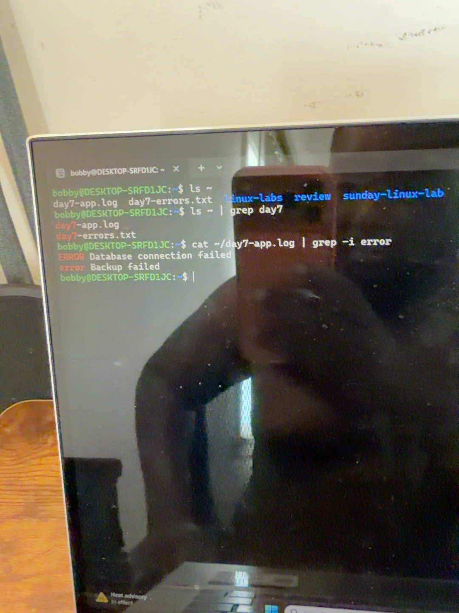
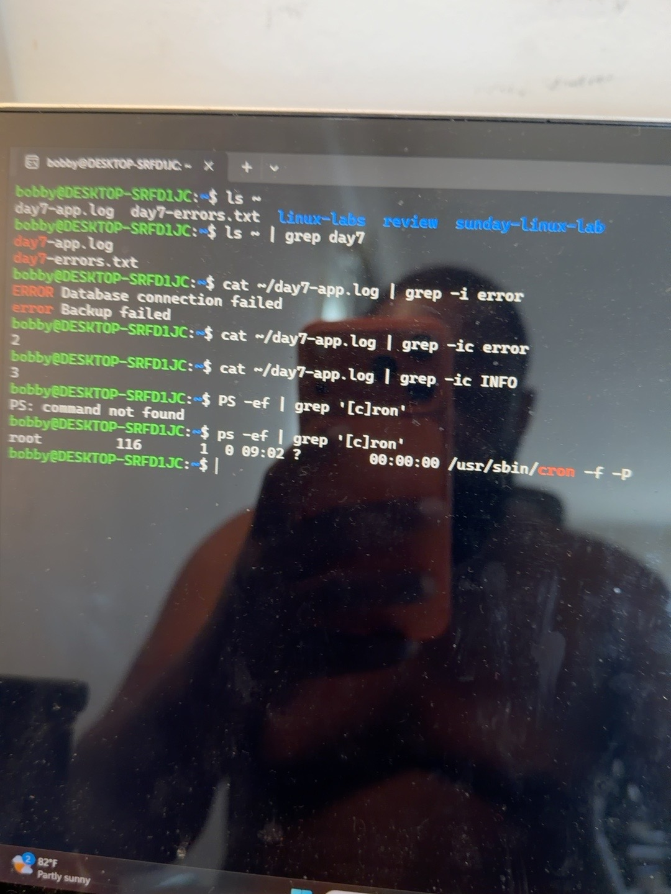
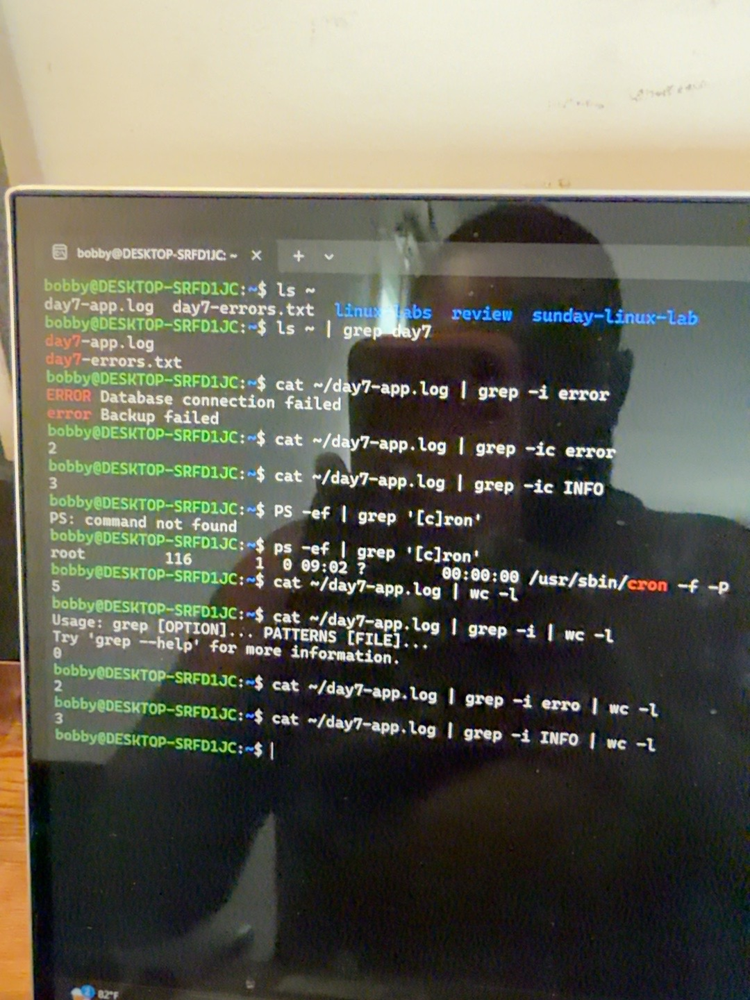
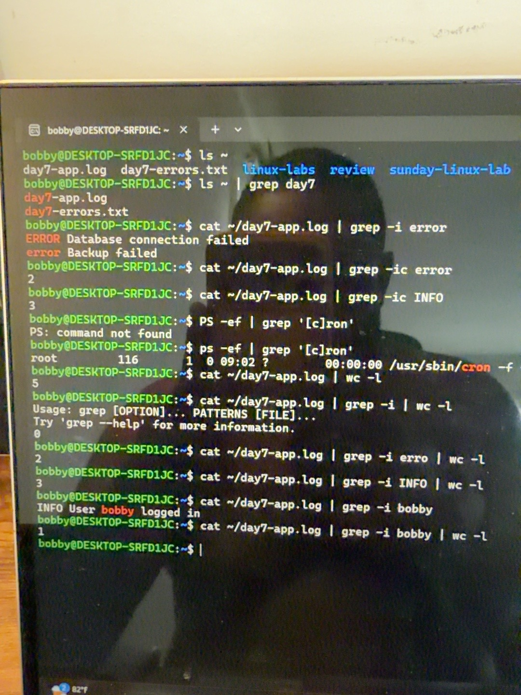

# Linux Day 8 — Pipes and Pipelines

## Goal

Practice passing one command's output to another command to filter filenames, search a log, find a running process, and count selected lines.

**Environment:** Ubuntu in Windows Subsystem for Linux (WSL), Bash shell.  
**Completed:** October 17, 2026.

## The main idea

A pipe (`|`) passes a command's standard output to the next command's standard input. In this lab, that output was text.

Each command does one job. Read the pipeline from left to right: produce text, select useful lines, then count them if needed.

| Command or symbol | What it does here |
| --- | --- |
| `~` | Refers to my home directory |
| `ls ~` | Lists names in my home directory |
| `cat FILE` | Outputs the contents of a text file |
| `grep WORD` | Selects lines containing the search pattern |
| `grep -i WORD` | Selects matches without distinguishing uppercase and lowercase |
| `wc -l` | Counts newline characters; the practice log has one newline per line |
| `ps -ef` | Lists running processes with details |
| `|` | Passes output to the next command |

These practice commands inspect information. They do not change the original log.

## 1. Filter filenames

```bash
ls ~
ls ~ | grep day7
```

The home directory contained these names at the time:

```text
day7-app.log
day7-errors.txt
linux-labs
review
sunday-linux-lab
```

The filtered result was:

```text
day7-app.log
day7-errors.txt
```

**Explanation:** `ls ~` produces the names. `grep day7` keeps names containing `day7`. This searches names in my home directory, not contents of a folder called day7.



## 2. Filter the contents of a log

I reused the practice log created in nano during Day 7. These are invented practice messages, not evidence of real application failures:

```text
INFO Application started
ERROR Database connection failed
INFO User bobby logged in
error Backup failed
INFO Application stopped
```

```bash
cat ~/day7-app.log | grep -i error
```

Result:

```text
ERROR Database connection failed
error Backup failed
```

**Explanation:** `cat` outputs all five lines. The pipe sends them to `grep`. With `-i`, both `ERROR` and `error` match. Only the two selected lines are displayed, while the original file keeps all five lines.

I also practiced counting directly with grep:

```bash
cat ~/day7-app.log | grep -ic error
# 2
cat ~/day7-app.log | grep -ic INFO
# 3
```

Here, `-c` counts matching lines and `-i` ignores letter case.

## 3. Find a running process

```bash
ps -ef | grep '[c]ron'
```

`ps -ef` produces the process list. `grep` selects lines containing `cron`. The pattern `[c]ron` matches `cron` while avoiding the usual match against the grep command's own literal pattern.

My output included:

```text
root  116  1  0  09:02  ?  00:00:00  /usr/sbin/cron -f -P
```

- `root`: account running the process.
- `116`: process ID (PID) in this screenshot; PIDs can change.
- `1`: parent process ID.
- `/usr/sbin/cron -f -P`: running command.

This showed a cron process running at the time of the check. Cron is used for scheduled tasks. The output alone does not prove that a particular scheduled task succeeded.

**Correction made:** I initially typed uppercase `PS`, which was not found. Lowercase `ps` worked. Linux command names are case-sensitive.



## 4. Count all lines, then count selected lines

```bash
cat ~/day7-app.log | wc -l
# 5
```

This sends the complete log to `wc -l`. The final character in `-l` is a lowercase L.

```bash
cat ~/day7-app.log | grep -i error | wc -l
# 2
```

Read the three stages in order:

1. `cat` supplies all five log lines.
2. `grep -i error` keeps the two error lines.
3. `wc -l` receives only those two lines and counts them.

```bash
cat ~/day7-app.log | grep -i INFO | wc -l
# 3
```

| Search or count | Observed result |
| --- | --- |
| All log lines | 5 |
| Lines containing error, ignoring case | 2 |
| Lines containing INFO | 3 |
| Lines containing bobby | 1 |

### Troubleshooting a missing search pattern

I accidentally ran:

```bash
cat ~/day7-app.log | grep -i | wc -l
```

`grep -i` was missing its search pattern, so grep printed a usage error. `wc -l` received no matching output and printed `0`. That zero was not a valid error count: an earlier stage had failed.

Adding the search word corrected the command. One screenshot shows `erro`, which also matched both error messages because it is a substring of `error`. The documented command uses the full word `error` for clarity.

**Lesson:** Read error messages from every stage before trusting a pipeline's final number.



## 5. Independent challenge: count lines mentioning bobby

Task: Read the log, select lines containing `bobby`, and count them.

I first checked the matching text:

```bash
cat ~/day7-app.log | grep -i bobby
```

```text
INFO User bobby logged in
```

Then I built the full pipeline:

```bash
cat ~/day7-app.log | grep -i bobby | wc -l
```

Result: **1 matching line**.

This counts lines containing the name. On a real log, it would not automatically mean one successful login unless the matching messages were specifically verified as successful login events.



## Practical use in IT support

Pipes help narrow down large amounts of output: find relevant log messages, count selected entries, or locate a process in a long list. The important skill is knowing what text each stage receives and produces.

For a simple file search, grep can read the file directly:

```bash
grep -ic error ~/day7-app.log
```

This also returns `2`. We used the longer pipeline to practice how commands pass output to one another.

## What I learned

- A pipe connects one command's output to the next command's input.
- Filtering filenames and filtering file contents are different tasks.
- `grep` selects lines from the text it receives.
- `wc -l` counts the lines passed to it in this newline-terminated practice log.
- A final count can be misleading if an earlier command failed.
- The original practice log remains unchanged by these pipelines.

## Included practice file

[examples/day7-app.log](examples/day7-app.log) is a copy of the five-line practice log, included for reference. The commands above use the existing file at `~/day7-app.log` in my WSL home directory.
