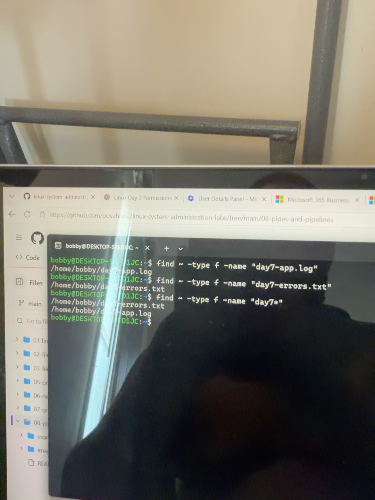
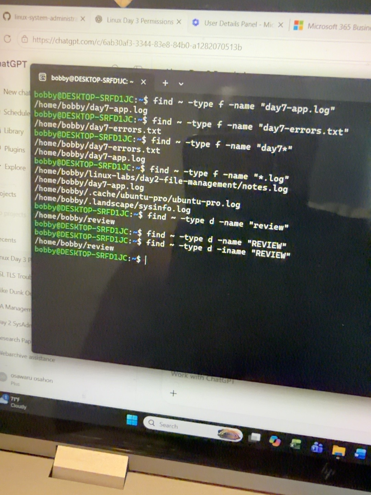
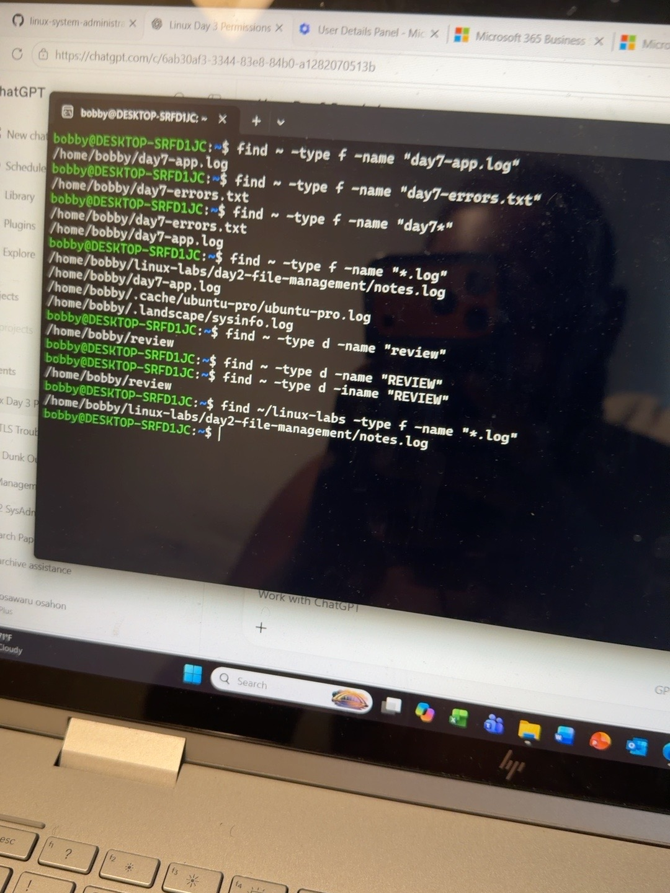
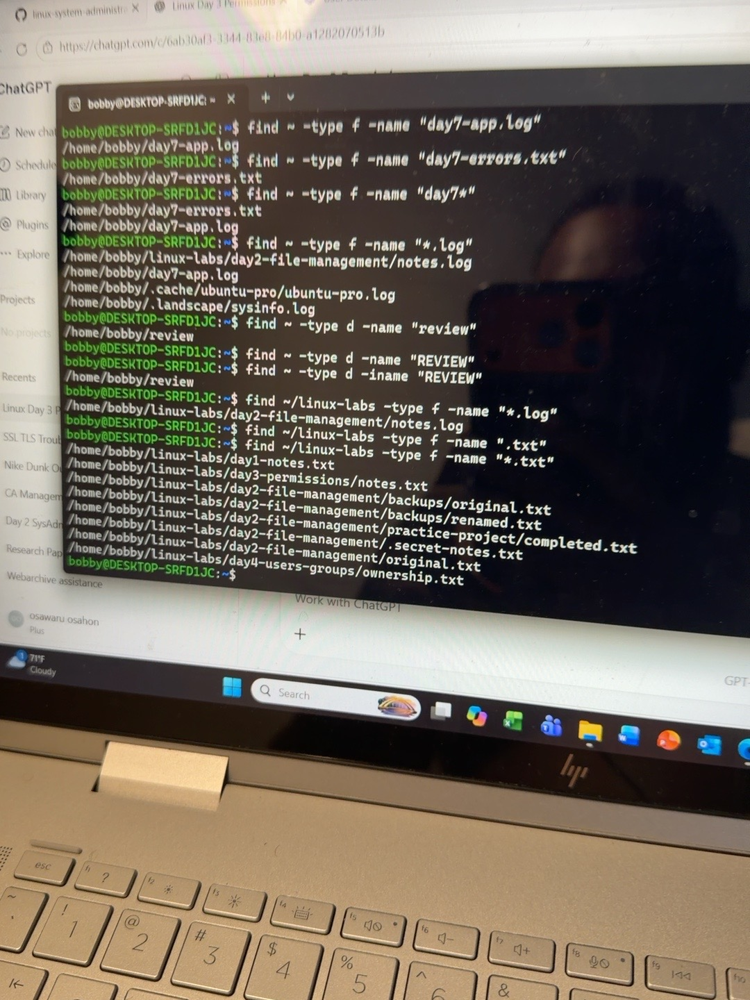
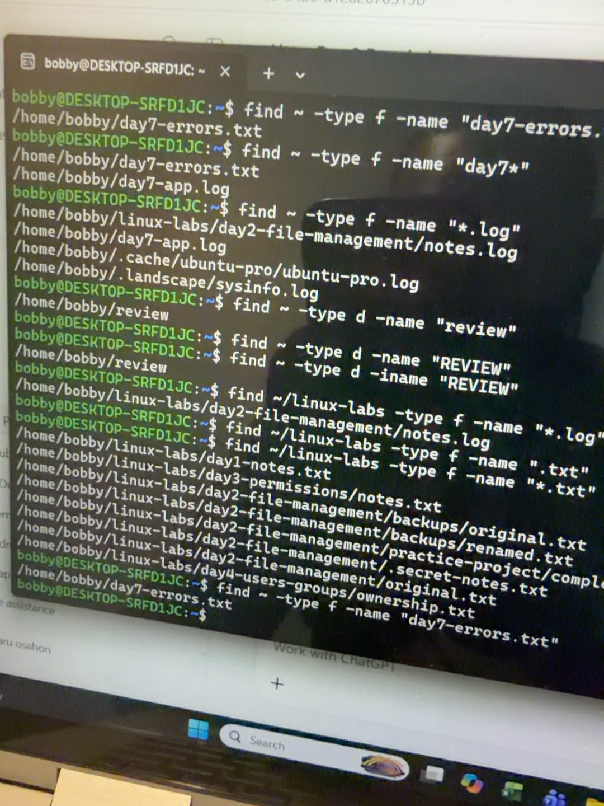

# Linux Day 9 — Finding Files and Folders

## Goal and environment

Locate existing files and folders with `find`, interpret their paths, and control the search by name, item type, and starting directory.

- **Environment:** Ubuntu in Windows Subsystem for Linux (WSL), Bash.
- **Completed:** October 21, 2026.
- **Practice:** Existing files and folders from earlier Linux labs.

## The main idea: where, type, name

```bash
find ~ -type f -name "day7-app.log"
```

Read this as: **Search my home directory and its subfolders for a file named day7-app.log.**

| Question | Command part | Meaning |
| --- | --- | --- |
| Where should I search? | `~` | My home directory and its subfolders |
| What kind of item? | `-type f` | Regular files |
| Which name? | `-name "day7-app.log"` | This exact filename |

`find` shows matching paths. The commands in this lab do not open, edit, move, or delete the matching files. These name searches do not search the text inside files.

## 1. Find files by exact name

```bash
find ~ -type f -name "day7-app.log"
```

Observed result:

```text
/home/bobby/day7-app.log
```

```bash
find ~ -type f -name "day7-errors.txt"
```

Observed result:

```text
/home/bobby/day7-errors.txt
```

A **path** tells me where an item is stored. Both files were directly inside `/home/bobby`, my home directory.


## 2. Find names beginning with day7

When I remember only the beginning of a filename, I can use a wildcard:

```bash
find ~ -type f -name "day7*"
```

The search returned both files:

```text
/home/bobby/day7-errors.txt
/home/bobby/day7-app.log
```

The `*` matches any sequence of characters, including no characters. `"day7*"` therefore matches names starting with `day7`.

Keep the pattern quoted so the shell passes it to `find` instead of expanding it first. Use straight quotes as shown in the command blocks. Result order is not guaranteed.



## 3. Find names ending in .log

```bash
find ~ -type f -name "*.log"
```

This searches for filenames ending in `.log` under my home directory. One result was:

```text
/home/bobby/linux-labs/day2-file-management/notes.log
```

This showed that `find` searches inside subfolders too.

| Part of this path | Meaning |
| --- | --- |
| `/home/bobby` | My home directory |
| `linux-labs/day2-file-management` | Folders inside it |
| `notes.log` | The matching file |


## 4. Find a folder and compare letter case

To search for a folder, change the type to `d`:

```bash
find ~ -type d -name "review"
```

Observed result:

```text
/home/bobby/review
```

- `-type f` selects regular files.
- `-type d` selects directories, which are folders.

Next I searched with uppercase letters:

```bash
find ~ -type d -name "REVIEW"
```

No matching path appeared. `-name` is case-sensitive, so `REVIEW` did not match `review`.

```bash
find ~ -type d -iname "REVIEW"
```

This returned `/home/bobby/review`. **`-iname` ignores uppercase and lowercase differences.** It changes how the name is matched; it does not rename the folder.



## 5. Limit where the search starts

```bash
find ~/linux-labs -type f -name "*.log"
```

Observed result:

```text
/home/bobby/linux-labs/day2-file-management/notes.log
```

This searched only `linux-labs` and its subfolders. It did not show `/home/bobby/day7-app.log`, because that file is outside `linux-labs`.

| Starting path | Search area |
| --- | --- |
| `~` | My home directory and its subfolders |
| `~/linux-labs` | Only linux-labs and its subfolders |

**Important distinction:** Change the starting path to change **where** to search. Change `f` or `d` to change **what kind of item** to find.



## 6. Find .txt files and correct a missing wildcard

My first attempt used:

```bash
find ~/linux-labs -type f -name ".txt"
```

This looked for a file named exactly `.txt` and returned no matching paths.

I corrected the pattern:

```bash
find ~/linux-labs -type f -name "*.txt"
```

The corrected search returned eight matching files, including:

```text
/home/bobby/linux-labs/day1-notes.txt
/home/bobby/linux-labs/day3-permissions/notes.txt
/home/bobby/linux-labs/day2-file-management/backups/original.txt
/home/bobby/linux-labs/day2-file-management/backups/renamed.txt
/home/bobby/linux-labs/day2-file-management/practice-project/completed.txt
/home/bobby/linux-labs/day2-file-management/.secret-notes.txt
/home/bobby/linux-labs/day2-file-management/original.txt
/home/bobby/linux-labs/day4-users-groups/ownership.txt
```

The missing `*` changed the meaning of the search. **No output means no matches were printed for those conditions; check the search area, item type, spelling, letter case, and wildcard before assuming the item is missing.** If errors appear, the search may also be incomplete.



## 7. Independent challenge

Task: Find the file `day7-errors.txt` anywhere inside my home directory.

I wrote and ran:

```bash
find ~ -type f -name "day7-errors.txt"
```

Result:

```text
/home/bobby/day7-errors.txt
```

I selected the home directory as the search area, files as the item type, and the exact filename to match.



## Quick reference

| Option or pattern | Meaning |
| --- | --- |
| `-type f` | Find regular files |
| `-type d` | Find directories (folders) |
| `-name` | Match the name with letter case respected |
| `-iname` | Match the name ignoring letter case |
| `"day7*"` | Names beginning with day7 |
| `"*.log"` | Names ending in .log |
| `"*.txt"` | Names ending in .txt |

## Practical use in IT support

If a user remembers a document's name but not where it was saved, `find` can help locate its path within the chosen area. A narrower starting directory keeps the search focused. Filename endings are useful search clues; they do not by themselves prove a file's contents or format.

## What I learned

1. Build each search by choosing **where**, **type**, and **name**.
2. Read the returned path to understand an item's location.
3. Use quoted wildcards when I remember only part of a name.
4. Choose `f` for files and `d` for folders.
5. Use `-iname` when letter case should not matter.
6. Check the conditions carefully when no matching paths appear.

**Write this down:** The starting path controls where I search. `-type` controls the kind of item. `-name` or `-iname` controls which names match.
